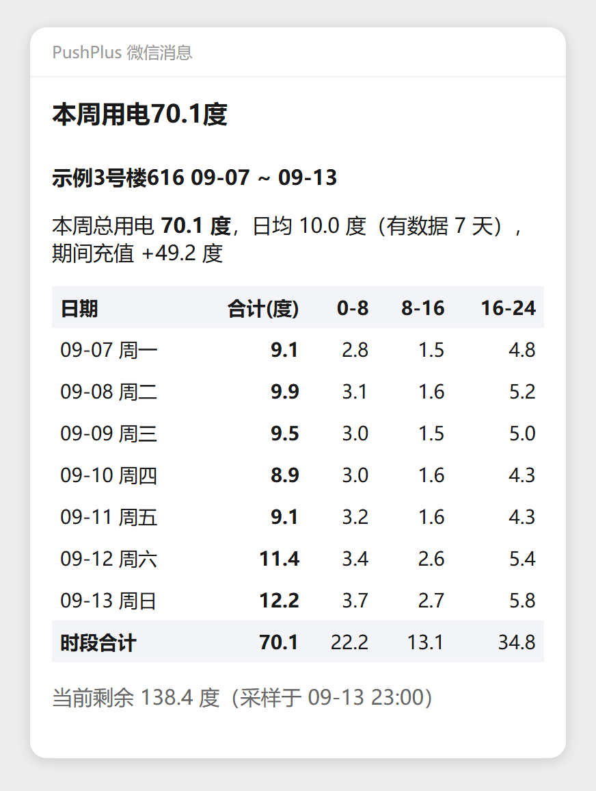
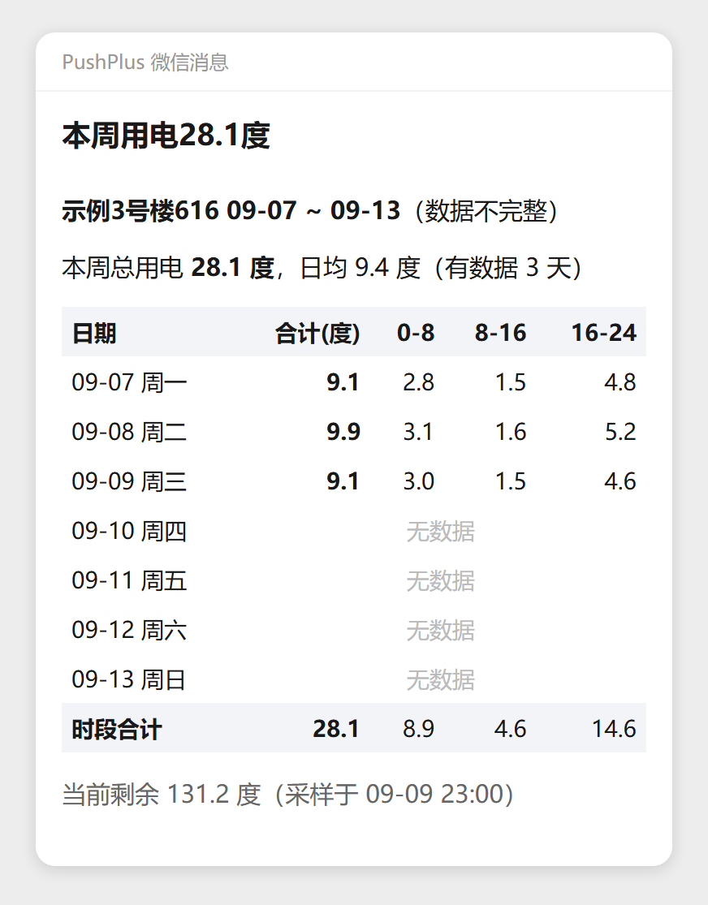
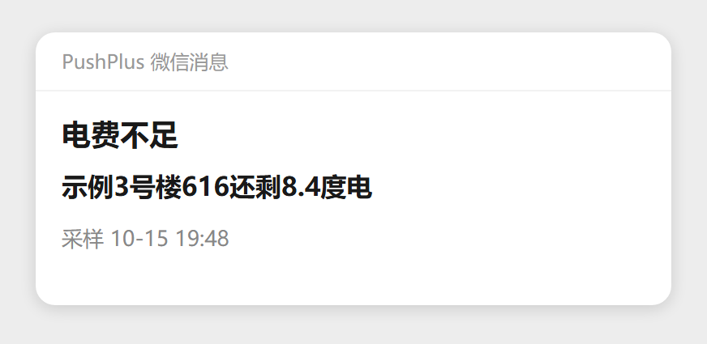
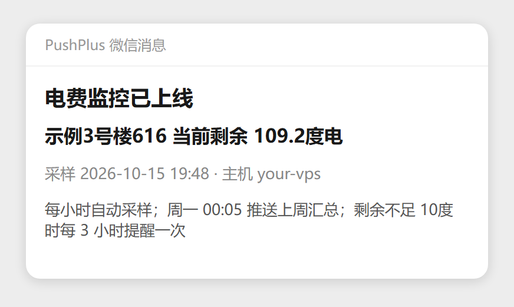
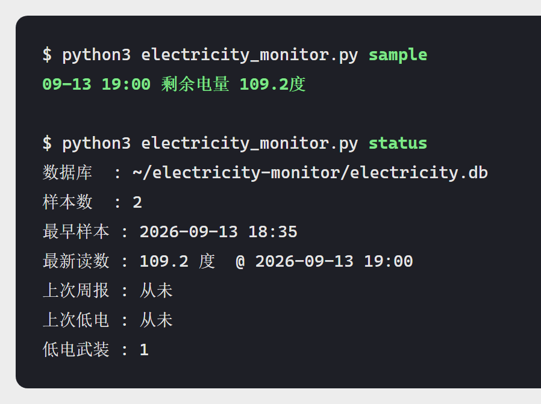
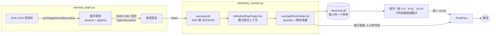

# 宿舍电费监控

每周用电汇总 + 电量不足提醒，直接推到微信。

适用于用「完美校园」App 交电费的学校。它每小时读一次宿舍剩余电量，周一凌晨推一张
按天、按时段的用电周报；剩余电量低于阈值时，每 3 小时提醒一次，直到你充值为止。

不需要模拟器，不需要长期抓包，不需要 root 的手机。服务器上纯账密登录即可自转。

MIT © [jialiangh](https://github.com/jialiangh)

## 你会收到什么

**每周一 00:05 的用电周报**，总量、每天用量、每天三个时段各多少度：



刚开始采集、数据不满一周时，缺数的天会明确标出来，不会把空白当成 0 度：



**剩余电量不足时**，10 度以内每 3 小时提醒一次：



部署完可以先跑一条自测，确认真机收到了：



本地台账长这样（SQLite，一条命令看概览）：



## 它是怎么工作的



一句话：**读数 = 剩余电量的下降量**。充值会让读数上升，这部分单独记账，不会被算进用电里。

## 快速开始

### 1. 装依赖

```bash
git clone https://github.com/jialiangh/campus-electricity-monitor.git
cd campus-electricity-monitor
pip install -r requirements.txt      # 只有 cryptography，其余全是标准库
cp config.example.json config.json   # 然后填自己的手机号、密码、学校代码
```

Python 3.8+（在 3.12 / 3.14 上实测过）。账号密码也可以不放文件里，改用环境变量
`WANXIAO_PHONE` / `WANXIAO_PASSWORD`。

### 2. 首次登录

```bash
python wanxiao_login.py login
```

如果回的是 `您正在新设备上使用完美校园，请使用验证码进行验证登录`，说明这台机器还没被
信任，补一次短信即可（**这是一次性的**，之后永远不用再验证码）：

```bash
python wanxiao_login.py sms-send
python wanxiao_login.py sms-code 收到的验证码
python wanxiao_login.py login          # 再试，应该直接成功且不要验证码
```

### 3. 找到你自己宿舍的参数

`schoolcode` 抓包看 App 任意请求里的 `customerId` 参数。剩下两个用现成命令查：

```bash
python electricity_monitor.py projects                       # 列出本校缴费项目
python electricity_monitor.py rooms --campus 南 --building 3 --room 616
```

`rooms` 会打印出 `roomverify`（形如 `101-07--112-308`），填进 `config.json` 的
`room.roomverify`；`projects` 打印的 `businesstype` 填进 `payPro.electric`。

> 整棵房间树有几百个节点，**一定要用 `--campus` / `--building` 剪枝**，
> 否则请求数会撞上限，也容易被前面的 WAF 限流。

### 4. 跑通

```bash
python electricity_monitor.py now        # 读一次当前剩余电量
python electricity_monitor.py test       # 读一次 + 推一条确认消息到微信
python electricity_monitor.py sample     # 采一次并写进台账
python electricity_monitor.py report --dry   # 按周报格式打印，不真推送
```

推送用的是 [PushPlus](https://www.pushplus.plus)，`pushplus_token` 在自己账号里拿。

## 放到服务器上

```bash
sudo mkdir -p /opt/electricity-monitor && sudo chown $USER /opt/electricity-monitor
cp wanxiao_login.py electricity_monitor.py config.json wanxiao_state.json /opt/electricity-monitor/
cd /opt/electricity-monitor && sh install_cron.sh
```

> **`wanxiao_state.json` 一定要一起拷过去。** 里面的 `deviceId` 就是"受信设备"的凭证，
> 带上它，新服务器不需要再过一次短信。删掉它等于自废武功。

装进去的是两条 cron（脚本幂等，且会原样保留服务器上已有的其它 crontab 条目）：

```cron
0 * * * *  flock -n $APP/.lock python3 electricity_monitor.py sample   # 每小时采样 + 低电量检查
5 0 * * 1  flock -n $APP/.lock python3 electricity_monitor.py report   # 周一 00:05 推上周汇总
```

服务器时区需要是 `Asia/Shanghai`，否则周报会在错误的时间触发。

不想用 cron 也可以常驻：`python electricity_monitor.py run`。

## 命令一览

| 命令 | 作用 |
| --- | --- |
| `projects` | 列出本校缴费项目，用于填 `payPro` |
| `rooms` | 下钻房间树，用于找 `roomverify`，支持 `--campus/--building/--room` |
| `now` | 强制重新登录并读一次剩余电量，不入库不推送 |
| `sample` | 采一次入库，顺带做低电量检查（cron 用这个） |
| `report` | 立刻按周报格式推送，`--dry` 只打印，`--force` 无数据也推 |
| `test` | 读一次 + 推一条部署确认消息 |
| `status` | 台账概览：样本数、最新读数、上次推送时间 |
| `run` | 常驻循环，不依赖 cron |
| `install` | 打印 cron / Windows 计划任务配置 |

登录模块单独也有 CLI：`wanxiao_login.py` 的 `status / login / sms-send / sms-code / sms / token`。

## 统计口径

- **用电量 = 相邻两次读数的下降量**。采样粒度 1 小时，所以单条数据的误差在 1 度以内。
- **跨时段按比例摊**。两次读数之间如果跨了 0 点、8 点或 16 点，这期间的用电按时长比例分到
  各自的时段和日期里，而不是全记在采样那一刻。否则每天第一笔会被错记到前一天。
- **充值不计入用电**。读数上升视为充值，单独在周报里显示「期间充值 +xx 度」，
  同时重新武装低电量提醒。
- **低电量提醒按 3 小时节流**，不会每小时轰炸你；电量归零后停发，避免彻底欠费时无限推送。
- **周报统计的是刚过完的自然周**（周一 00:00 至周日 24:00），周一凌晨触发。
  数据不满 7 天时照推，缺数的天显示「无数据」并标注（数据不完整）。

## 常见问题

**某天开始就不推了？**
先看 `monitor.log`。多数是 `deviceId` 没了（换机器、删状态文件）导致重新触发新设备风控，
日志里会明确写「未绑定受信设备」。在服务器上补一次 `sms-send` + `sms-code` 即可。
token 本身过期不用管，脚本发现取不到数据会自动重新登录再试一次。

**返回一堆空数据但没报错？**
这是 token 失效的典型表现。服务端不会拒绝请求，而是默默给你一个匿名会话，
缴费项目列表变成空。代码里以「项目列表非空」作为 token 有效的唯一判据。

**HTTP 405 / 熔断 `code_:9004`？**
站点前面有 WAF，短时间请求过密会整个域名返回拦截页，几分钟内自愈。默认每小时一次的
频率远低于这个阈值，别自己把它调成秒级轮询。

**想同时监控水表？**
`projects` 里冷水是另一个 `payProId`（`businesstype=1`，单位「吨」），同一条链路直接能读。

## 注意事项

- 这是**非官方**实现，靠逆向 App 得到接口。学校或厂商随时可能改动协议，届时需要重新适配。
- 只查询**你自己的**账号。把 token、`deviceId`、`config.json`、`wanxiao_state.json`
  当成密码对待，别提交进仓库，别贴到群里。
- 本项目仅供学习和便利自己生活，请遵守学校的相关规定。

## 协议细节

登录加密链、CloudPayment 五步取数、Referer 的隐藏要求、验证码接口的两个变体差异，
以及踩过的坑，都记在 [docs/接口说明.md](docs/接口说明.md) 里。

## 测试

推送与统计逻辑有一组自检，不联网、不真推送：

```bash
python tests/selftest.py
```

覆盖时段切分、跨天差值归属、充值识别、低电量 3 小时节流、标题文案。

## License

[MIT](LICENSE)
